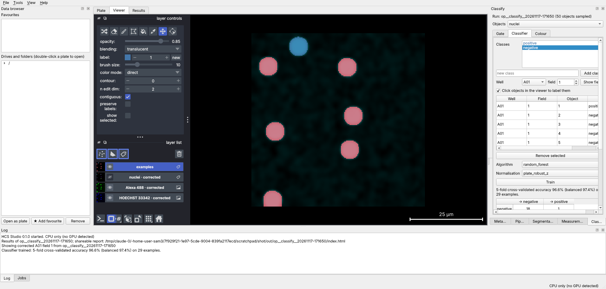
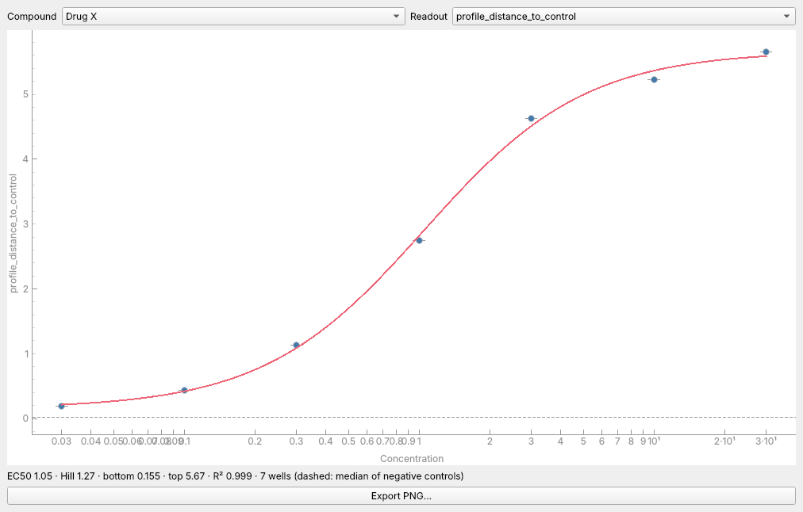

# HCS Studio user guide

## Start

Install HCS Studio with the Windows installer or from Python (see [install.md](install.md)),
then start **HCS Studio** from the Start menu, or `python -m hcs_studio`. The status bar
shows the detected GPU, or "CPU only" with the reason. Help → Show test image displays a
synthetic image to confirm that the viewer works; `hcs-studio selftest` checks the whole
installation in about a minute. If something goes wrong, see
[troubleshooting.md](troubleshooting.md). To validate HCS Studio on your own instruments
(counts, colocalization, deconvolution, unattended plates), follow
[acceptance.md](acceptance.md).

## Open a plate

Use the **Data browser** (left), File → Open plate folder, or File → Open image file.
Folders recognised as plates are marked `▦ name [Vendor]`. Double-click one to open it.
Selected folders can be kept under **Favourites**.

| Source | What to select |
|---|---|
| Nikon | a `.nd2` file, or a folder of `.nd2` files |
| Operetta CLS | the export folder (the one containing `Images/Index.idx.xml`) |
| ImageXpress | the folder containing the `.HTD` file |
| OME-TIFF / OME-Zarr | the `.ome.tif` file or the plate `.zarr` folder |
| Other TIFF folders | the folder; you are asked for a filename pattern |

For Nikon data, well names are read from the XY position names, or from the file names
(`WellB02_…`). If neither contains well names, each file is shown as one well in file-name
order and a warning says so.

## Plate map and fields

The **Plate** tab shows the plate with its real geometry. Wells that contain images are
filled. Hover over a well for a preview; click it to list its fields; click a field to
open it in the **Viewer** tab with channel names, colours, a micrometre scale bar and a
Z slider. Previews are contrast-stretched for orientation only.

Warnings under the plate title list anything the reader had to assume.

## Metadata

The **Metadata** dock shows what was read from the files. Pixel size, Z step, NA,
magnification, immersion RI, pinhole, modality and channel names can be corrected and
saved with **Save overrides**. Overrides are stored in `~/.hcs_studio/overrides/`
(or `HCS_STUDIO_HOME`), never in the raw data folder.

## Plate layout (Layout tab)

The **Layout** tab describes what is in every well: cell line, treatments (one compound,
or several for combinations, each with a concentration, unit and vehicle), role, passage,
cells per well, time point, notes and custom fields. Opening a plate loads the latest saved
layout of that plate; the plate map, results, report and tables then show it.

**Selecting wells.** Click a well; Shift+click or drag for a rectangle; Ctrl+click to add;
click a row letter or column number for the whole row or column. The filter bar selects
wells by annotation, e.g. cell line *MCF7*, compound *Drug X*, ≥ 100 nM; the same bar is
on the Plate and Results tabs.

**Editing.** The form on the right shows the first selected well. Editing a field ticks
its box; **Apply ticked fields to selection** changes only those fields in every selected
well (so you can set the cell line of a whole plate without touching its doses). Undo and
redo (Ctrl+Z / Ctrl+Y), copy and paste (Ctrl+C / Ctrl+V, pasted at the first selected
well) work on whole annotations.

**Fill helpers.**

| Helper | What it does |
|---|---|
| Dilution series | from the first selected well, left → right or top → bottom: top concentration, dilution (1:2, 1:3, 1:10, ½-log or a custom factor), number of points, replicates in the next rows/columns, highest concentration first or last |
| Combination matrix | at the first selected well: drug A down the rows, drug B across the columns (6 × 6 by default), each with its own top concentration and dilution; with 0 included, the first row and column are the single agents and the corner is the vehicle control; replicate matrices to the right or below, with a gap |
| Controls | marks the selection as vehicle controls (e.g. "DMSO 0.1"), positive controls or blanks (no cells) |
| Exclude edge wells | marks the outer ring as excluded, and restores it when unticked |

A 384-well 6 × 6 combination plate (three replicate matrices plus control columns) takes
three helper actions; a plate of eight 10-point compounds in duplicate takes nine.

**Colour by** cell line, compound, concentration (log scale; single agents in molar
units — combinations and % vehicles stay grey), role or replicate group;
tooltips show the full annotation of each well.

**Concentrations and units.** Enter any unit (M, mM, µM, nM, pM, g/L, mg/mL, µg/mL,
ng/mL, %, …). Values are stored in base units (mol/L, g/L, fraction) and shown in the unit
you entered; molar and mass units are never mixed unless a molecular weight is given.
Treatments are order-free: *A + B* and *B + A* are the same combination. A concentration
of 0 means the drug is absent (the single-agent edge of a matrix).

**Replicate groups** are derived from cell line + treatments (and role for controls), so
replicate wells group automatically; type a group name to override.

**Validate** lists problems; click one to select its wells:

| Problem | Level |
|---|---|
| wells with cells but no cell line | error |
| sample wells without a treatment | warning |
| treated wells marked empty or blank | error |
| no vehicle (negative) controls, or fewer than three | error / warning |
| one compound entered in different unit kinds (molar and mass) | error |
| one compound shown in different units | warning |
| a combination matrix without the single-agent rows/columns | warning |

**Versions.** **Save version** stores the layout as version 1, 2, … for this plate in
`~/.hcs_studio/layouts/` (or `HCS_STUDIO_HOME`); versions are never overwritten. A new run
uses the layout you see: unsaved edits are saved as a new version when the run starts. The
run folder keeps a copy (`plate_layout.json`, `plate_layout.csv`) and `run_manifest.json`
records its version and SHA-256. Changing names, doses or roles does not prevent resuming
a run; only unstained/blank wells (used by autofluorescence correction) do.

**Templates.** Templates → Save as template keeps the layout pattern; Apply template
asks for the new cell line and compound names (e.g. the same combination layout for a
different drug pair).

**Import and export.** Import… (or File → Import plate layout) reads:

- a long table (CSV or XLSX), one row per well: `well`, `cell_line`, `role`,
  `compound_1`, `conc_1`, `unit_1`, `vehicle_1`, `compound_2`, … , `passage`,
  `seeding_density`, `replicate_group`, `time_point_h`, `notes`; unknown columns become
  custom fields. Common names are recognised (`drug`, `dose`, `concentration`, `Drug A`,
  `conc_b`, `cells_per_well`, …); if the columns are not clear, a dialog asks what each
  column holds. Older layouts with `compound`, `concentration`, `treatment` and
  `control_type` (`negative`, `positive`, `unstained`, `blank`) still work.
- a plate-map workbook: one sheet per field (`cell_line`, `compound_1`, `conc_1`, …), each
  laid out like the plate (row letters down, column numbers across);
- a saved layout (`.json`).

Export writes the long CSV or XLSX (metadata in `# key: value` lines or a `plate` sheet),
the plate-map XLSX, a figure of the current colouring (PNG or PDF) or JSON. CSV → import →
export gives the identical file. Two examples to try: `docs/examples/combo_6x6_384.csv`
(three 6 × 6 matrices with control columns) and `docs/examples/drc_10pt_384.csv` (eight
compounds, 10 points in duplicate).

From the command line:

```bash
hcs-studio layout layout.xlsx --validate
```

```bash
hcs-studio layout layout.csv --export platemap.xlsx --plate-map
```

```bash
hcs-studio layout layout.csv --export layout.pdf --layer concentration
```

```bash
hcs-studio annotate <run folder> --layout corrected_layout.csv
```

`annotate` applies a corrected layout to a finished run: tables, profiles and the report
are rebuilt without reprocessing any image (it refuses if unstained/blank wells changed).

## Checking a reader against the vendor software

`hcs-studio inspect <path>` prints the detected format, plate geometry, dimensions,
optics, channels and the first wells. Compare these with the values shown by
NIS-Elements, Harmony or MetaXpress.

## Correction and enhancement

The **Pipeline** dock (tab next to Metadata) holds an ordered list of steps. Choose a
module, click **Add step**, and edit its parameters below the list. Untick a step to
skip it. **Save…** and **Load…** store the pipeline as a YAML file that can be re-run
on another plate. See [processing.md](processing.md) for every module.

**Preview on current field** runs the steps up to the selected one on the field shown
in the viewer. **Show** switches between After, Before and Side by side, and the
histograms compare one channel before and after. Tick **Live** to re-run the preview
whenever a parameter changes. Previews estimate plate-level corrections from at most
24 fields and show the first timepoint only.

### Z projection and background removal

`scripts/pipelines/projection_background.yaml` is the recommended order: flat-field →
(autofluorescence) → (deconvolution) → **projection** → **background removal**. Load it
in the Pipeline dock (Load…) and untick what you do not need; steps can be reordered.

**Projection** (`projection`) works on every field, channel and well of a run:

| Option | Choices |
|---|---|
| method | **max** (default), mean, sum, min, std, edf (extended depth of field: `variance` = sharpest plane per pixel, `pyramid` = multi-scale fusion, smoother at boundaries) |
| planes | **all**; range (first/last plane, counted from 1); auto (the `n_planes` planes around the best focus by normalized variance or Brenner; per channel, or chosen by one `focus_channel` for all) |

The planes used for each field and channel (and the focus score of every plane, for
auto) are stored in `well_summary.json` → `fields[].reports`.

**Background removal** (`background`), one method per step (add several steps with
different `channels` to use different methods per channel):

| Method | What it removes | Use |
|---|---|---|
| tophat | morphological opening with a disk of `radius_um` | fast default |
| rolling_ball / paraboloid | a ball / paraboloid rolled under the image (ImageJ-style, shrunk for large radii) | smooth backgrounds |
| gaussian / median | a large blur (bright objects ignored), subtracted or divided | uneven, slowly varying background |
| polynomial / spline | a smooth surface fitted to background pixels only (objects left out iteratively), subtracted or divided | illumination gradients; divide for multiplicative shading |
| constant | a percentile of each field, or the mean of blank (no-cell) wells of the plate layout | camera offset, medium autofluorescence |
| basic | flat-field and dark-field estimated from many (projected) fields across the plate (BaSiC-style: I = S·B + D) | shading not corrected before projection |

Morphological methods (tophat, rolling ball, paraboloid) are estimated on a 3 × 3 mean of
the image so that noise does not leave a positive floor. Negative values are clipped to
0; the output stays float and linear, so intensities are measured on background-removed
data, never on contrast-stretched images.

For every field and channel, the report records the change of the mean intensity inside
objects and in the background, and the typical object diameter. If the radius is less
than 2× the typical object diameter (estimated from the image, or `object_diameter_um`),
a warning appears in the preview, the log and `well_summary.json` → `warnings`: such a
radius removes signal.

**Checking the result.** Preview the step, choose **Side by side**, then click **Line
profile…** and draw a line in the viewer: the Pipeline dock plots the intensity along it
before and after (raw data as maximum over Z), for the channel chosen for the histograms.

**Outputs.** Projected fields are written as 2D OME-TIFFs (`*_corrected.ome.tif`) with
8-bit preview PNGs. In the run dialog (or `--image-dtype original`), *Saved images* can
be the camera's bit depth instead of 32-bit float: values are rounded and clipped (the
number of clipped pixels is recorded and logged); measurements always use the float
values. `stitch_well` with `save_mosaic: true` also writes each well as one linear
image (`wells/<W>/mosaic.ome.tif`, all channels, overlaps averaged, downsampled by
`mosaic_downsample`).

### Display-only results

Steps marked **◐ display only** (contrast, CLAHE, sharpen, clarity) change intensities
non-linearly. Their output is for viewing and as segmentation input. Each run writes
two images per field: `*_corrected.ome.tif` (linear data from before the first ◐ step:
use this for measurements) and `*_enhanced.ome.tif` (display only).

### Running a pipeline on wells and plates

Build the pipeline in the **Pipeline** dock: add steps, drag them into order, untick a
step to skip it. **Preview up to selected step** runs the steps up to the selected one
on the field in the viewer; **Preview all steps** runs them all. **Save…** stores the
pipeline as a YAML file that can be loaded again or used from the command line.

**Run on plate…** opens the run dialog. Choose the scope:

| Scope | Runs on |
|---|---|
| Current field | the field shown in the viewer |
| Current well | every field of that well |
| Selected wells | the wells selected on the plate map |
| Whole plate | every well |
| Whole plate, and other plates | this plate plus the plate folders you add (one job each) |

Select wells on the plate map by clicking, **Ctrl+click** (add/remove one well),
**Shift+click** (a rectangle from the last clicked well) or by dragging a rectangle.

The run then waits in the **Jobs** dock (tab next to Log). Jobs run one after another,
each in its own process, so the application stays responsive. Within a job, wells are
processed by several worker processes (*auto* picks the number from the CPU cores and
memory). Steps that use the GPU run one at a time across workers; a pipeline with SAM 3
uses one worker, since each worker would load its own copy of the model.

The Jobs dock shows the overall progress with an estimate of the time left, and the
status of every well. **Pause** stops starting new wells; **Cancel** stops after the
wells in progress. **Retry failed wells** reruns only the wells that failed, in the same
run folder. **Resume a run folder…** continues a run that was cancelled, interrupted or
cut short by a crash or power cut. Completed wells are skipped, and the plate-level
estimates (flat-field and similar) are reused, so the result is identical to an
uninterrupted run. A well is only complete once all its fields are written; a well
interrupted part-way is done again.

Resuming refuses a run folder that was made with a different pipeline, plate,
metadata or plate layout: start a new run instead.

### From the command line

The same runs can be started without the application, for example overnight:

```bash
hcs-studio run --pipeline pipe.yaml --input <plate folder> --wells A01-H12 --workers auto
```

| Option | Meaning |
|---|---|
| `--input` | plate folder or file; repeat it to run several plates |
| `--wells` | `all` (default), `A01-H12`, `B02,B03`, … |
| `--workers` | number of worker processes, or `auto` (default 1) |
| `--output` | output root (default: next to the raw data, never inside it) |
| `--layout` | plate layout (CSV, XLSX, plate-map XLSX or JSON) |
| `--no-checksums` | record input file size and time instead of SHA-256 |
| `--no-images` | do not save corrected images; masks, previews and all tables are still written (run folders shrink to about a quarter) |
| `--image-dtype` | `float32` (default) or `original`: save corrected images in the camera's bit depth (rounded, clipped; half the size) |
| `--max-memory-gb` | RAM the whole run may use; limits the number of workers and the deconvolution tile size |
| `--resume <run folder>` | continue an interrupted run (plate and pipeline are read from the folder) |
| `--retry-failed <run folder>` | rerun only the wells that failed |

The exit code is 0 when every well succeeded, 1 when some wells failed, 2 when the run
could not start, and 130 when it was stopped with Ctrl+C (it stops after the current
field; resume it later with `--resume`).

Before it starts, a run checks that the output disk has room for its outputs and refuses
otherwise. If the disk fills up during a run anyway, the run stops at once (instead of
failing every remaining well) and can be resumed once space is freed. Each run records
where its time went (`performance` in `run_manifest.json`: time per step summed over all
fields, reading, writing, fields per minute, peak memory per worker, output size) and
each well its own timings in `well_summary.json`. Each run folder is named `<Plate>__<Pipeline>__<date-time>` and
contains `run_manifest.json` (with the history of every attempt), `pipeline.yaml`,
`logs/run.log`, `wells/<well>/…` and `tables/`.

## Results

When a job finishes, the **Results** tab opens with the run's plate. Open any earlier run
with **File → Open results…**.

- **Readout**: any per-well value (counts, density per mm², feature means and medians,
  colocalization medians, QC counts). Type in the filter box to narrow the list.
- **% positive**: choose an object type, a feature and a threshold, then
  **Show % positive** (e.g. % nuclei with `ki67_mean` > 800). Fields excluded by QC are
  left out.
- **Scale**: the values, or robust Z-scores, (x − median) / (1.4826 × MAD), either over
  the whole plate or over the negative-control wells of the plate layout.
- **Z′** is shown when the layout marks at least two positive and two negative control
  wells: ≥ 0.5 excellent, 0–0.5 acceptable, < 0 no separation.

Click a well to see its annotation, QC flags, key statistics and fields. **Show** switches
the previews between *Enhanced*, *Corrected* (linear, after flat-field, autofluorescence
and deconvolution) and *Raw*; the tick boxes show or hide the outlines of each
segmentation. **Open in viewer** opens the field's image and masks in the viewer;
**Compare raw / corrected / enhanced** places the three side by side (the raw image is
read again from the plate folder, so it must still be available).

### Shareable report

Each run folder contains `index.html`: the same results plate, readouts, robust Z,
Z′ and well panels, in one file that opens in any browser. It needs no network
connection or software. Zip the run folder (or at least `index.html` and `wells/`) to
share it; clicking a well shows its previews with the stage and outline switches.
Arrow keys move between wells, and `index.html#C07` opens well C07 directly.
Regenerate it with:

```bash
hcs-studio report <run folder>
```

## Deconvolution

Add a **Deconvolution** step to the pipeline. By default it computes a theoretical
PSF for each channel from the metadata (objective NA, immersion and sample refractive
index, emission wavelength, pixel size, Z step, confocal or widefield). It stops with
a message naming anything that is missing; fill it in on the Metadata panel. Choose
the iteration count on a representative field and keep it for the whole plate.

To use a measured PSF, open the bead stack (or the field with beads) in the viewer,
then **Tools → PSF tool…**, choose *Measured (bead stack)* and **Compute PSF**. The
dialog shows XY and XZ projections and the FWHM. **Save PSF…** writes an OME-TIFF and
sets it as the PSF of the Deconvolution step. The same dialog shows the theoretical
PSF for comparison.

The preview reports, per channel, the iterations, the residual (how far the
re-blurred result is from the data), the runtime and the number of tiles. A GPU is
used automatically when PyTorch can see one. Images too large for the memory budget
are split into overlapping tiles automatically; set `max_memory_gb` to change the
budget. To see how long deconvolution takes on your machine:

```bash
hcs-studio benchmark --shape 30 2048 2048 --iterations 40
```

Deconvolution output stays linear (usable for measurements). It is classic RL/TV
deconvolution: validate it against Huygens on bead and cell images before using it
for quantitative claims. See [validation.md](validation.md).

## Segmentation

Segmentation steps go in the same pipeline as the corrections. They read the image as it
is at that point, so contrast or clarity steps placed before them improve detection,
while measurements (Phase 5) still use the linear data. Each step creates a named
**label set** (`nuclei`, `cells`, `spots`, …):

| Step | Use it for |
|---|---|
| Segmentation: Cellpose | nuclei and whole cells, high throughput (default `cpsam_v2`) |
| Segmentation: threshold + watershed | well-separated nuclei; fast fallback without a model |
| Segmentation: SAM 3 (text concept) | organoids, spheroids, unusual objects, by describing them |
| Cells from nuclei (expansion) | cells as nuclei grown outward; cell *n* contains nucleus *n* |
| Spot detection (LoG / DoG) | sub-cellular spots, each linked to its cell |
| Filter objects | remove edge objects, wrong sizes, shapes or intensities |

A typical hierarchy is *Cellpose (nuclei) → Cells from nuclei, or Cellpose on the
cytoplasm channel with `parent: nuclei` → Spot detection (`parent: cells`) → Filter*.
Every object records its parent ID.

After **Preview**, each label set appears in the viewer as an editable labels layer.

### Editing and SAM 3 in the viewer

The **Segmentation** dock (tab next to Pipeline) works on the selected labels layer:

- **Paint, erase, fill**: use napari's own tools in the viewer's layer controls.
- **Merge / Delete**: type object IDs (hover over an object to see its ID).
- **Split**: *Add seed layer*, click two or more points inside the object, enter its
  ID, *Split*.
- **SAM 3**: type a concept (e.g. "mitotic cell") and *Segment all instances*, or
  *Add prompt layers*, click positive and negative points or draw boxes, then
  *Segment from points/boxes*. SAM works on the displayed Z plane.

### Training data and fine-tuning Cellpose

Correct a segmentation, then **Save as training pair**: the image and its masks are
written to the training folder as `*_img.tif` / `*_masks.tif` (Cellpose's format).
With enough pairs, **Fine-tune Cellpose** trains a new model from the chosen base model.
The result is set as the model of the pipeline's Cellpose step. From the command line:

```bash
hcs-studio train-cellpose --data <training folder> --base cpsam_v2 --epochs 100
```

Fine-tuning needs a GPU in practice. Validate a fine-tuned model on fields that were not
used for training.

### Setting up SAM 3

SAM 3 needs its own Python environment because it requires numpy < 2:

```bash
uv venv --python 3.12 .venv-sam3
```

```bash
uv pip install --python .venv-sam3/bin/python torch torchvision einops pycocotools psutil "setuptools<81" -e <path to the sam3 repository>
```

(`einops`, `pycocotools`, `psutil` and `setuptools` are imported by SAM 3 but not declared
by it.) The weights are gated: request access to **facebook/sam3** on Hugging Face and
wait for approval, then log in with `huggingface-cli login` in that environment, or
download `sam3.pt` yourself. In **Tools → SAM 3 settings**, choose that environment's
Python (and the checkpoint, if downloaded) and click *Check environment*.

SAM 3.1 is a video-tracking release; still images use the SAM 3 image model. A GPU is
strongly recommended. On the CPU, encoding an image takes about 5-10 s and each prompt
about 1 s.

**Choosing between Cellpose and SAM 3.** In our tests SAM 3's concept prompt found every
nucleus in a confocal field of large nuclei, but almost none in a dense field of 300+
small nuclei, where Cellpose found them all. Use Cellpose for batch segmentation of
nuclei and cells; use SAM 3 to correct objects with a click, and for spheroids,
organoids and unusual objects. Concept prompts depend strongly on wording ("cell
nucleus" worked where "nucleus" found nothing), so try a few phrasings. SAM 3 does not
tell phenotypes apart: "mitotic cell" returns ordinary nuclei too. See
[validation.md](validation.md).

### Output

Each run writes, per field, `masks/<field>_<label set>.ome.tif` (label images),
`masks/<field>_<label set>_parents.csv` (object → parent links), and the object counts in
`well_summary.json`. The PNG previews show outlines: nuclei yellow, cells magenta, spots
cyan.

## Measurements, colocalization and QC

Measurement steps go after the segmentation steps. They do not change the image; they
produce tables. They always measure the linear image, whatever display-only steps come
before them, using the segmentations made so far.

| Step | Produces |
|---|---|
| Measure: objects | `objects.parquet` per well: shape, intensity, texture, spots per cell, neighbours ([columns](measurements.md)) |
| Measure: colocalization | `coloc.csv` per well: Pearson, Manders M1/M2 and tM1/tM2 with Costes thresholds, ICQ, optional randomization p-value |
| Measure: field QC and counts | focus and saturation per field; flags and counts per well |
| Register channels | (correction) removes chromatic shift before measuring |

A typical end of pipeline: *Cellpose (nuclei) → Cells from nuclei → Spot detection →
Filter objects → Measure: objects → Measure: colocalization → Measure: field QC*.

After the run, `tables/` holds `per_object_all.parquet` (every object of the plate),
`per_well_summary.csv` (counts, densities per mm², feature means/medians/SDs,
colocalization medians), `per_field.csv`, `qc_flags.csv` and `coloc_all.csv`. Parquet
files open in Python (pandas), R (arrow), KNIME, Spotfire or Excel (via Power Query).

### QC and counting

Fields whose focus score is below half the plate median are flagged *out of focus*;
fields with more than 0.1 % saturated pixels are flagged *saturated*; wells with fewer
than 30 % of the plate's median count are flagged *low count*. Out-of-focus fields are
left out of the counts by default; edge fields (outermost row and column of a well's
grid of 9 or more fields) can be left out too. All thresholds are parameters of the QC
step.

### Colocalization in the viewer

The **Measurements** dock shows the tables of the last preview and analyses
colocalization on the field in the viewer: choose two channels and a region (whole
field, all cells, or one cell by its ID), then **Cytofluorogram** to see the 2D
intensity histogram with the Costes regression line and thresholds.
**Colocalization map** adds an nMDP image (positive where both channels are above their
mean). The analysis uses the linear, background-subtracted data, never the enhanced
display.

Warnings appear when pixels are saturated in the raw data or when the channels look
shifted (chromatic shift). Image multicolour beads and add **Register channels** with
that bead image to correct the shift.

### Comparing with Fiji Coloc 2

**Export for Fiji…** writes the exact inputs of the current region (background-subtracted
channel A and B and the mask), HCS Studio's results, and a macro `coloc2_compare.ijm`.
Run the macro in Fiji and compare Coloc 2's values with `hcs_studio_results.json`. The
mapping is in the macro's comments. Coloc 2 reports the Costes p-value as 1 − p.

## Whole wells, classification and clustering

### Stitching wells

Add **Stitch well** to a pipeline to place each well's fields in one coordinate system.
The stage positions come from the plate files. When fields overlap, HCS Studio works out
which way the stage axes run (instruments differ) and refines the positions by matching
the overlaps (phase correlation, sub-pixel), so each field lands within a pixel of where
it really was. Fields that do not overlap keep their stage positions.

Each object then has whole-well coordinates (`well_x_um`, `well_y_um`). An object imaged
twice in an overlap is kept once: the copy in the field whose centre is nearer counts, and
the other is marked `in_overlap_duplicate`. Well counts and densities count each object
once and use the area the fields cover together. **Results → Whole-well mosaic** shows the
well at preview resolution. Images are not fused: measurements stay on the original
fields.

### Table steps

Gates, classifiers, phenotypic clusters and spatial statistics are *table steps*. They run
once every well is done, on the object tables, so they can see the whole plate. Their
results go into `objects_annotations.parquet` per well (the measurements are never
rewritten), the merged `tables/per_object_all.parquet`, and new per-well columns in
`tables/per_well_summary.csv`, so they appear as readouts on the results plate and in the
report. What each step did is recorded in `tables/analysis_summary.json`.

Table steps can also be applied to a finished run without reprocessing any image: from the
**Classify** dock (**Apply to run**) or with

```bash
hcs-studio analyze <run folder> --pipeline steps.yaml
```

The run's own table steps run first; add `--only` to run just the file's steps.

### The Classify dock

The dock works on the run open in the Results tab. Choose the object type at the top.



**Gate.** Pick a feature for a histogram, or two for a scatter plot, and drag the shaded
region (or type the limits). The dock shows how many sampled objects fall inside. **Add
gate to pipeline** or **Apply gate to run**; each object gets `gate_<name>` and each well
the count and fraction inside.

**Classifier.** Name your classes, choose a well and field and press **Show field**. Click
objects in the viewer to label them with the selected class (click again to undo); labelled
objects are coloured. Label examples in several wells, including controls, then **Train**.
The dock reports the cross-validated accuracy and the confusion matrix (rows: the class
you gave; columns: the class predicted). **Suggest uncertain objects** lists the objects the
classifier is least sure about; double-click one to see it, label it, and train again. A
few rounds of this usually beat labelling many easy objects. **Save classifier…** keeps it
as a `.joblib` file with its feature list, normalisation and accuracy; **Add to pipeline**
or **Apply to run** classifies every object (`class_<name>`, its probability, and every
class probability) and adds class counts and fractions per well.

With *plate robust Z* normalisation (the default) every plate's features are first turned
into robust Z-scores of that plate, which removes plate-to-plate brightness differences.
It assumes most objects on a plate are similar; on a plate where nearly all objects belong
to one class, choose *none*. Classifiers are pickle files: only open ones you trust.

From the command line, label objects in a CSV (`well, field, object_id, label`) and run

```bash
hcs-studio train-classifier --run <run folder> --labels labels.csv --output model.joblib
```

**Colour.** Colours the objects of the shown field by any class, gate, cluster or colony
column, with a legend.

### Phenotypic clusters

**Phenotypic clusters** groups objects by their features without labels (k-means, HDBSCAN,
or Leiden if `leidenalg` and `igraph` are installed). Clusters are learned on objects
sampled across the plate, then every object is assigned. `cluster_<name>` holds the
cluster (1 = largest, -1 = noise); wells get the fraction in each cluster; the analysis
summary lists the features that set each cluster apart.

### Spatial statistics

**Spatial clusters** describes how objects are arranged, over the whole well (needs
**Stitch well**) or per field: colonies (DBSCAN with a distance `eps_um`, or HDBSCAN),
nearest-neighbour distances, Clark–Evans ratio, Voronoi area and Delaunay neighbours per
object, and Ripley's H(r) and pair correlation g(r) compared with randomly placed objects
in the same area. `spatial_pattern_<r>um` is +1 where objects are more clustered than
random at that distance, -1 where more regular. Full curves are in
`wells/<W>/analysis.json`. See [measurements.md](measurements.md) for every column.

## Phenotypic profiles (PCA, UMAP, dose-response)

The **Profiles** tab compares wells and objects by all their measured features at once. It
works on the run open in the Results tab; **Add plate (run folder)…** adds other plates of
the same screen. Choose the objects, then **Compute profiles** (it runs in the background
and is saved in the run's `advanced/` folder, so it is there next time).


How the profiles are made:

1. **Features.** Every measured feature present on all plates, minus those missing in more
   than 10 % of objects, those where 95 % of objects share one value, and then one of
   each pair correlating above |r| = 0.95 (the one more correlated with the rest). The
   **Scree and loadings** tab lists what was dropped and why.
2. **Normalisation.** Per plate, each feature becomes a robust Z-score relative to the
   objects in the **negative-control wells** of the plate layout:
   (x − median) / (1.4826 · MAD). This removes plate-to-plate differences in staining and
   imaging. Without negative controls in the layout, all wells are used (with a note).
   *Centre each plate* additionally subtracts each plate's median profile.
3. **Embedding.** PCA (scree plot, loadings) and UMAP (`n_neighbors`, `min_dist`, metric
   and seed are recorded; the same seed gives the same picture). *Embed objects* uses up
   to `Objects sampled` objects spread evenly over the wells; *Embed wells* uses one
   profile per well.
4. **Well profiles and distance to control.** A well's profile is the median of its
   objects' Z-scores. `profile_distance_to_control` is the distance of that profile from
   the median negative-control profile (in the principal components that explain 90 % of
   the variation), in units of object-to-object variation: a well whose objects shifted by
   2 SD in one feature scores about 2. `profile_distance_ratio` divides it by the typical
   distance of the control wells themselves (noisy with few control wells). Both appear as
   readouts on the results plate.

In the plot, **Colour by** controls/compounds, concentration, well, class, gate or cluster.
Click a point to see that object (a crop of its field) and **Open selected object in
viewer**; switch on **Lasso** and draw around points to mark their wells on the results
plate. Clicking a well on the results plate enlarges its points. **Export PNG/SVG** saves
the plot as shown; **Export coordinates** saves the table behind it.

The **Dose-response** tab plots any per-well readout against concentration for each
compound in the layout (mean ± SD of replicate wells, negative-control median dashed) and
fits a four-parameter logistic curve: EC50, Hill slope, bottom, top and R². A fit needs at
least 4 concentrations; an EC50 outside the tested range is marked as extrapolated.



From the command line:

```bash
hcs-studio profile <run folder> [<run folder of another plate> ...] --object-type nuclei
```

writes `advanced/` (PCA and UMAP coordinates, loadings, variance, well profiles,
`dose_response.csv`, `figures/` as SVG and PNG, and `profiling.json` with every option and
the features used) and updates the run's `index.html`, which then has a linked PCA/UMAP
panel: click a point to open its well, drag a rectangle to mark wells on the plate.

## Limitations in this phase

- Readers have been tested on synthetic plates only, not yet on real instrument exports.
- RGB `.nd2` files are not supported.
- ImageXpress does not record confocal vs widefield; set the modality manually.
- ImageXpress field positions are nominal (site grid), not measured stage positions.
- Operetta flat-field profiles are not read yet.
- The correction, enhancement, segmentation and measurement modules are verified on synthetic images only;
  colocalization has not yet been compared with Fiji Coloc 2 on real fields.
- SAM 3 was checked with its trained weights on one public image set only (see
  validation.md); its quality on your images is unverified.
- SAM 3 segments 2D planes; 3D SAM 3 segmentation is not available.
- Noise2Void and BM3D denoising are not included yet.
- Apart from deconvolution, every field is processed whole in memory.
- Stitched mosaics are previews; fields are not blended into one full-resolution image.
- Classification, clustering and spatial statistics are verified on synthetic data only.
- Profiles of several plates are saved with the first plate's run; the other runs' reports
  do not show them.
